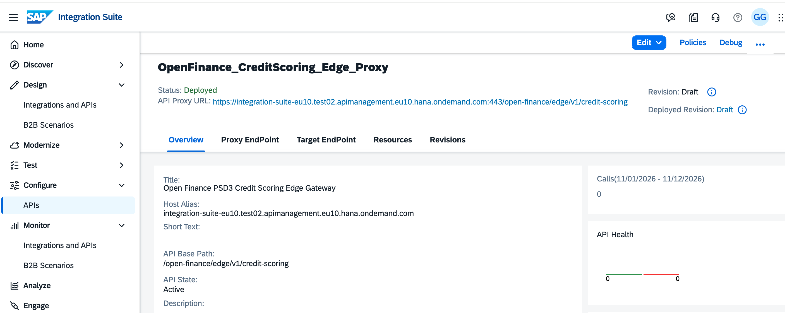
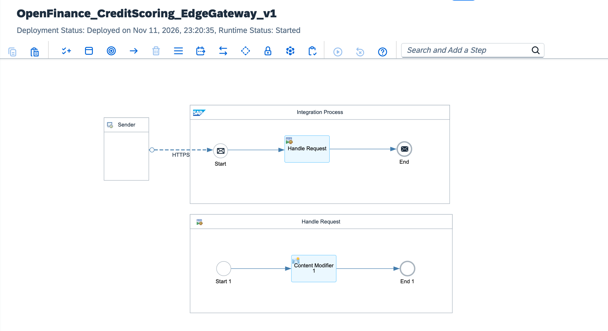

# SAP API Management Edge Gateway: PSD3 Open Finance Credit Scoring & Monetization

[](https://www.sap.com)
[](https://ec.europa.eu)
[](#4-declarative-apim-policy-definitions-xml)
[](#1-live-deployment--implementation-evidence)

An enterprise-grade Edge API Gateway implemented on **SAP Integration Suite (API Management + Cloud Integration)**. This solution establishes strict perimeter defense, per-call monetization metering, and regulatory compliance with the **EU PSD3 (Payment Services Directive 3)** framework for external Third-Party Providers (TPPs), banking partners, and FinTech applications querying real-time creditworthiness assessments.

---

## 1. Live Deployment & Implementation Evidence

### 1.1. SAP API Management Edge Proxy (`OpenFinance_CreditScoring_Edge_Proxy`)
Configured with perimeter traffic protection (`PreFlow`) and real-time monetization/compliance header injection (`PostFlow`), actively deployed on the SAP APIM runtime gateway:



### 1.2. SAP Cloud Integration Backend (`OpenFinance_CreditScoring_EdgeGateway_v1`)
Deployed backend integration flow acting as the S/4HANA Credit Assessment Engine simulator, isolated behind the APIM reverse proxy:



---

## 2. Two-Tier Enterprise Architecture

The architecture enforces a strict separation of concerns by decoupling perimeter security, rate limiting, and billing telemetry (Edge Layer) from core financial orchestration and backend processing (Integration Layer):

```text
  [ External TPPs / FinTech Applications / Banking Partners ]
                             │
                             │ HTTPS (TLS 1.3 / Strict API Base Path)
                             ▼
  ┌────────────────────────────────────────────────────────────────────────┐
  │ 1. SAP API Management (APIM Edge Gateway Layer)                        │
  │    Proxy Name: OpenFinance_CreditScoring_Edge_Proxy                    │
  │    Base Path:  /open-finance/edge/v1/credit-scoring                    │
  │                                                                        │
  │   [ProxyEndpoint ──► PreFlow (Inbound Request Pipeline)]               │
  │   ├── Spike Arrest Policy: 100 ps (DDoS & Micro-Burst Mitigation)      │
  │   └── Quota Policy: 10,000 req / month / Client IP (Tier-1 Contract)   │
  │                                                                        │
  │   [ProxyEndpoint ──► PostFlow (Outbound Response Pipeline)]            │
  │   └── Assign Message Policy: Inject PSD3 & Monetization Headers        │
  │       (X-OpenFinance-Standard, X-Monetization-Cost-USD: $0.05)         │
  └──────────────────────────────────┬─────────────────────────────────────┘
                                     │
                                     │ Mutual TLS / Internal HTTPS Runtime
                                     ▼
  ┌────────────────────────────────────────────────────────────────────────┐
  │ 2. SAP Cloud Integration (CPI Processing Backend Layer)                │
  │    Artifact: OpenFinance_CreditScoring_EdgeGateway_v1                  │
  │    Endpoint: /http/open-finance/v1/credit-scoring                      │
  │                                                                        │
  │   [Integration Process]                                                │
  │   ├── HTTPS Sender Adapter (Role-Based Auth: ESBMessaging.send)        │
  │   ├── Content Modifier (S/4HANA Credit Scoring Core Simulator)         │
  │   └── Deterministic Financial JSON Payload & Limit Response     │
  └────────────────────────────────────────────────────────────────────────┘
```

### End-to-End Request & Response Lifecycle
1. **Perimeter Ingestion:** External consumers invoke the public APIM Edge URL over HTTPS (`Port 443`).
2. **DDoS & Spike Filtering (`PreFlow`):** `SpikeArrest_DDoS_Guard` smooths traffic bursts at `100ps` per client IP address before any quota counters or backend connections are allocated.
3. **Contractual Quota Enforcement (`PreFlow`):** `Quota_Monthly_Tiering` validates the caller's monthly consumption against the `10,000` calls/month Tier-1 SLA, rejecting excess traffic immediately with `HTTP 429 Too Many Requests`.
4. **Backend Orchestration:** Validated requests are routed securely to the SAP Cloud Integration runtime endpoint (`/http/open-finance/v1/credit-scoring`), which executes the credit risk evaluation.
5. **Monetization & Compliance Tagging (`PostFlow`):** `Assign_Monetization_Headers` intercepts the outbound payload and appends non-repudiation billing metadata (`$0.05` unit cost, subscription tier, and `PSD3-COMPLIANT` status) prior to returning `HTTP 200 OK` to the consumer.

---

## 3. Component & Policy Specification Matrix

| Component | Policy / Artifact Name | Architecture Layer | Pipeline Phase | Technical Parameters | Enterprise Purpose |
| :--- | :--- | :--- | :--- | :--- | :--- |
| **DDoS Guard** | `SpikeArrest_DDoS_Guard` | APIM Edge Gateway | `PreFlow` (Request) | `Rate: 100ps`, `Identifier: client.ip`, `UseEffectiveCount: true` | Protects backend worker nodes from volumetric spikes and micro-bursts. |
| **Monetization Quota** | `Quota_Monthly_Tiering` | APIM Edge Gateway | `PreFlow` (Request) | `Allow: 10000`, `Interval: 1`, `TimeUnit: month` | Enforces B2B Tier-1 volume limits per client IP and blocks overages at the edge. |
| **PSD3 & Billing Headers** | `Assign_Monetization_Headers` | APIM Edge Gateway | `PostFlow` (Response) | `Cost: $0.05 USD`, `Standard: PSD3-COMPLIANT` | Injects auditable billing telemetry and regulatory compliance headers into responses. |
| **Backend Core Simulator** | `OpenFinance_CreditScoring_EdgeGateway_v1` | CPI Runtime Engine | Integration Flow | `HTTPS Inbound`, `ESBMessaging.send`, `JSON Payload` | Processes authorized credit inquiries and returns structured risk scores and limits. |

---

## 4. Declarative APIM Policy Definitions (XML)

All policies adhere strictly to the SAP Integration Suite XSD schema sequence requirements.

### 4.1. Spike Arrest (`policies/SpikeArrest_DDoS_Guard.xml`)
Attached to **ProxyEndpoint ──► PreFlow (Request)**. Eliminates sudden traffic surges at the network edge.
```xml
<?xml version="1.0" encoding="UTF-8" standalone="yes"?>
<SpikeArrest async="false" continueOnError="false" enabled="true" xmlns="[http://www.sap.com/apimgmt](http://www.sap.com/apimgmt)">
    <Identifier ref="client.ip"/>
    <Rate>100ps</Rate>
    <UseEffectiveCount>true</UseEffectiveCount>
</SpikeArrest>
```

### 4.2. Quota Management (`policies/Quota_Monthly_Tiering.xml`)
Attached to **ProxyEndpoint ──► PreFlow (Request)**. Enforces rolling monthly API consumption limits per consumer IP.
```xml
<?xml version="1.0" encoding="UTF-8" standalone="yes"?>
<Quota async="false" continueOnError="false" enabled="true" xmlns="[http://www.sap.com/apimgmt](http://www.sap.com/apimgmt)">
    <Identifier ref="client.ip"/>
    <Allow count="10000"/>
    <Interval>1</Interval>
    <TimeUnit>month</TimeUnit>
</Quota>
```

### 4.3. Assign Message (`policies/Assign_Monetization_Headers.xml`)
Attached to **ProxyEndpoint ──► PostFlow (Response)**. Injects financial metering and EU PSD3 compliance headers into the outbound HTTP response.
```xml
<?xml version="1.0" encoding="UTF-8" standalone="yes"?>
<AssignMessage async="false" continueOnError="false" enabled="true" xmlns="[http://www.sap.com/apimgmt](http://www.sap.com/apimgmt)">
    <Set>
        <Headers>
            <Header name="Content-Type">application/json; charset=utf-8</Header>
            <Header name="X-OpenFinance-Standard">PSD3-COMPLIANT</Header>
            <Header name="X-Monetization-Cost-USD">0.05</Header>
            <Header name="X-Monetization-Plan">B2B_PARTNER_CREDIT_SCORING_TIER_1</Header>
        </Headers>
    </Set>
    <IgnoreUnresolvedVariables>true</IgnoreUnresolvedVariables>
    <AssignTo createNew="false" transport="http" type="response">response</AssignTo>
</AssignMessage>
```

---

## 5. Backend Integration Service (SAP Cloud Integration)

The backend integration flow (`OpenFinance_CreditScoring_EdgeGateway_v1`) runs on the SAP BTP Cloud Integration runtime tenant and exposes an internal HTTPS endpoint consumed exclusively by the APIM TargetEndpoint:

* **Target Runtime Endpoint:** `https://integration-suite-eu10.it-cpi026-rt.cfapps.eu10-002.hana.ondemand.com/http/open-finance/v1/credit-scoring`
* **Transport & Authorization:** HTTPS with User Role Authorization (`ESBMessaging.send`)
* **Deterministic Response Schema (`application/json`):**
```json
{
  "CreditScoreResult": {
    "borrowerTaxId": "DE-TAX-998810234",
    "creditRatingScore": 785,
    "riskClass": "LOW_RISK_TIER_A",
    "approvalDecision": "AUTOMATICALLY_APPROVED",
    "maximumApprovedCreditLimitEUR": 25000.00,
    "s4hanaAssessmentTimestamp": "2026-11-11T23:15:00Z"
  }
}
```

---

## 6. Verification & End-to-End Testing

### 6.1. Authorized Request Execution (`HTTP 200 OK`)
```bash
curl -i -X GET \
  "[https://integration-suite-eu10.test02.apimanagement.eu10.hana.ondemand.com:443/open-finance/edge/v1/credit-scoring](https://integration-suite-eu10.test02.apimanagement.eu10.hana.ondemand.com:443/open-finance/edge/v1/credit-scoring)" \
  -H "Accept: application/json"
```

**Expected Gateway Response (Headers + Body):**
```http
HTTP/1.1 200 OK
Content-Type: application/json; charset=utf-8
X-OpenFinance-Standard: PSD3-COMPLIANT
X-Monetization-Cost-USD: 0.05
X-Monetization-Plan: B2B_PARTNER_CREDIT_SCORING_TIER_1

{
  "CreditScoreResult": {
    "borrowerTaxId": "DE-TAX-998810234",
    "creditRatingScore": 785,
    "riskClass": "LOW_RISK_TIER_A",
    "approvalDecision": "AUTOMATICALLY_APPROVED",
    "maximumApprovedCreditLimitEUR": 25000.00,
    "s4hanaAssessmentTimestamp": "2026-11-11T23:15:00Z"
  }
}
```

### 6.2. Traffic Violation & Quota Exhaustion (`HTTP 429 Too Many Requests`)
When a client exceeds the `100ps` spike threshold or exhausts the `10,000` calls/month allocation, the Edge Gateway terminates the request immediately without invoking the CPI backend:
```http
HTTP/1.1 429 Too Many Requests
Content-Type: application/json

{
  "fault": {
    "faultstring": "Spike arrest violation or Quota limit exceeded",
    "detail": {
      "errorcode": "policies.ratelimit.QuotaViolation"
    }
  }
}
```

---

## 7. Repository Structure

```text
.
├── README.md                                       # Complete architectural & policy documentation
├── sap-apim-edge-proxy-policies-deployed.png       # APIM Edge Proxy deployment & policy flow evidence
├── sap-apim-open-finance-edge-gateway.png          # SAP CPI backend iFlow runtime deployment evidence
├── docs/
│   ├── adr/
│   │   └── ADR-025-edge-gateway-monetization.md    # Architectural Decision Record
│   └── open-finance-psd3-spec.md                   # EU PSD3 & Open Finance API specification
├── iflow/
│   └── OpenFinance_CreditScoring_EdgeGateway_v1.json # CPI backend integration metadata & payload
├── policies/
│   ├── SpikeArrest_DDoS_Guard.xml                  # PreFlow DDoS & spike arrest XML policy
│   ├── Quota_Monthly_Tiering.xml                   # PreFlow monthly quota tiering XML policy
│   └── Assign_Monetization_Headers.xml             # PostFlow PSD3 & billing headers XML policy
└── tests/
    └── test-edge-gateway.sh                        # Automated cURL verification script
```

---

## 8. Architectural Decision Record (ADR-025)

* **Status:** Accepted & Deployed
* **Context:** Exposing SAP Cloud Integration flows or S/4HANA core banking services directly to external Open Finance consumers introduces severe denial-of-service risks, unthrottled compute consumption, and a lack of per-transaction billing visibility.
* **Decision:** Implement a dedicated SAP API Management Reverse Proxy (`OpenFinance_CreditScoring_Edge_Proxy`) as a perimeter Edge Gateway upstream of SAP Cloud Integration. Enforce declarative XML policies (`SpikeArrest`, `Quota`, and `AssignMessage`) across `PreFlow` and `PostFlow` pipelines.
* **Consequences:**
  * **Security & Resilience:** Backend integration worker nodes are completely insulated from traffic volatility and volumetric attacks.
  * **Cost Governance:** Over-quota and burst traffic are rejected at the edge with sub-millisecond latency without consuming CPI message processing units.
  * **Regulatory & Billing Readiness:** Every successful API response carries standardized EU PSD3 compliance metadata and unit-cost billing headers (`$0.05 USD`) for downstream financial reconciliation.

---

**Integration Architect:** Željko Popov
